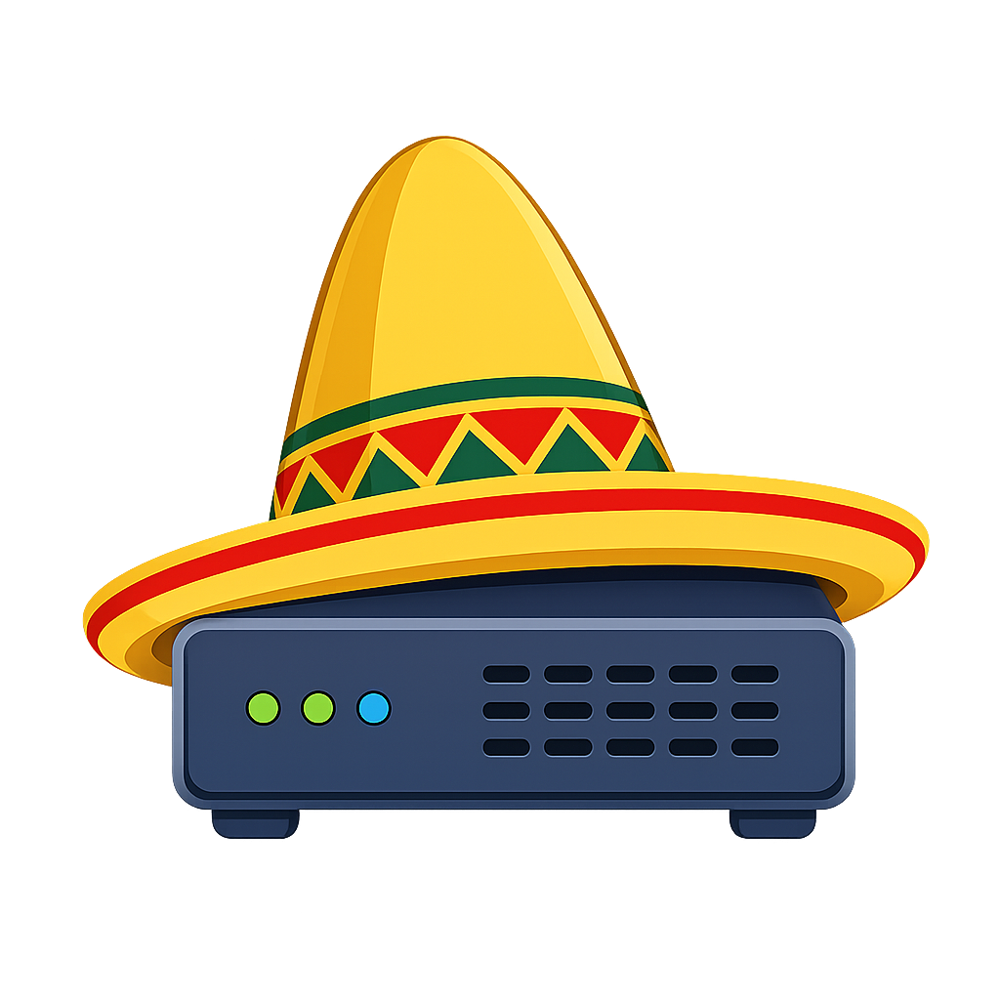

# Sombrero
This is an SMB server integrated into the Sia decentralized cloud storage. Users can connect to it from their PCs and access the Sia storage like they would normally do with a regular remote drive.

## Prerequisites
* At least one `renterd` or `indexd` node running either locally or on a remote machine is required. The node needs to be funded, have the minimal required number of active storage contracts, and be accessible from the machine where the server is running.
Even though it is possible to use a single or multiple remote `renterd` nodes, it is recommended to run the node locally, to avoid an overhead caused by the additional Internet traffic.
How to set up a `renterd` node is described here: [https://github.com/SiaFoundation/renterd](https://github.com/SiaFoundation/renterd).
The setup process of an `indexd` node is described here: [https://github.com/SiaFoundation/indexd](https://github.com/SiaFoundation/indexd). Alternatively, one can connect to the [Sia Foundation indexer](https://sia.storage/).
* The SMB port 445 needs to be open on the machine where the server is running.

## Installing on Ubuntu
On Ubuntu, the installer script does the whole setup: it installs the server, sets PostgreSQL up in the Normal mode, writes the configuration, and runs the server as a systemd service under a user of its own.
```Bash
curl -fsSLO https://raw.githubusercontent.com/mike76-dev/sombrero/master/install-sombrero.sh
sudo bash install-sombrero.sh
```
It asks for the mode and an API password, and prints how to reach the web UI when it is done. Run it again to upgrade the server to the latest release; the configuration and the data are kept. `sudo bash install-sombrero.sh --help` lists the options.

The released binaries need Ubuntu 26.04 / Debian 13 or newer. On an older system, use the Docker image or build from source.

The sections below describe the same setup by hand, which is also what to follow on the other systems.

## Installing PostgreSQL
This section will assume you are running Ubuntu Server 26.04. On the other systems, the commands may be different.

The default Ubuntu repositories ship an older PostgreSQL version, so add the official PostgreSQL (PGDG) repository first:
```Bash
sudo apt install postgresql-common -y
sudo /usr/share/postgresql-common/pgdg/apt.postgresql.org.sh -y
```
Then install PostgreSQL 18:
```Bash
sudo apt install postgresql-18 postgresql-contrib -y
```
Verify the installation:
```Bash
sudo systemctl status postgresql
```
You should see something like:
```
● postgresql.service - PostgreSQL RDBMS
     Loaded: loaded (/lib/systemd/system/postgresql.service; enabled)
     Active: active (exited)
```
If it is inactive, start and enable it:
```Bash
sudo systemctl enable --now postgresql
```
PostgreSQL creates a Unix user named postgres. Switch to it:
```Bash
sudo -i -u postgres
```
Then open the PostgreSQL shell:
```Bash
psql
```
You should see something like:
```
psql (18.x)
Type "help" for help.

postgres=#
```
Inside the `psql` prompt:
```SQL
CREATE DATABASE <DATABASE>;
CREATE USER <USER> WITH ENCRYPTED PASSWORD '<DB_PASSWORD>';
GRANT ALL PRIVILEGES ON DATABASE <DATABASE> TO <USER>;
\c <DATABASE>
GRANT USAGE ON SCHEMA public TO <USER>;
GRANT CREATE ON SCHEMA public TO <USER>;

```
Take a note of `<DATABASE>`, `<USER>`, and `<DB_PASSWORD>`, as you will need these values later on.
Exit `psql` with:
```SQL
\q
```

## Running the Server
A config file, `sombrero.yml`, needs to be created in the directory where the server will be running. It should contain the following lines:
```YAML
debug: false               # indicates whether to display the session ID and key for tools like Wireshark to decrypt the encrypted data,
                           # also enables or disables verbose logging
mode: normal               # the server mode: 'normal' or 'lite' (see below)
maxConnections: 30         # the maximum number of connections open at once from the same IP; one more gets the IP banned
anonymous: false           # optional: whether clients presenting no credentials at all are admitted; a share
                           # has to offer it as well (see below). If omitted, they are turned away
api:
  address: 127.0.0.1:9999  # the address the API is listening on; defaults to localhost, since the API administers
                           # the whole server. Change it only if the API needs to be reached from another machine,
                           # and put a reverse proxy with TLS in front of it if you do
  password: <API_PASSWORD> # the password to access the API; the server refuses to start without one
database:
  host: 127.0.0.1          # the address of the PostgreSQL server
  port: 5432               # the port number of the PostgreSQL server
  user: <USER>             # the name of the database user from the previous section
  password: <DB_PASSWORD>  # the password of the database user from the previous section; should be at least 4 characters long
  database: <DATABASE>     # the name of the PostgreSQL database from the previous section
  sslMode: disable         # the SSL mode of the PostgreSQL server
indexd:
  appName: Sombrero                                                              # the name of the app, unique to the `indexd` node being connected to
  description: Sombrero SMB server                                               # description of the app
  logoURL: https://raw.githubusercontent.com/mike76-dev/sombrero/master/logo.png # URL of the app logo, can be left as it is
  serviceURL: https://github.com/mike76-dev/sombrero                             # URL of the app itself, can be left as it is (Sombrero has no service page)
  seedPhrase: ''                                                                 # if omitted, the server will generate a new seed phrase and put it here
  maxBufferAge: never                                                            # optional: how long the data that does not fill a slab may wait to be packed
                                                                                 # with the data of other files; if omitted, it waits indefinitely
  fragmentationThreshold: 0.25                                                   # optional: how much of a slab may be dead space before it is reported, as a fraction
                                                                                 # between 0 and 1; if omitted, defaults to 0.25
  fragmentationCheck: 1h                                                         # optional: how often to look for the dead space; 'never' turns the check off and leaves
                                                                                 # it to the web UI and the API to report on demand
  defragment: false                                                              # optional: whether the check also repacks the slabs it reports, instead of only reporting
                                                                                 # them; if omitted, nothing is repacked on its own
  maxBufferedData: 0                                                             # optional: the most data, in bytes, that all shares may keep in the database waiting
                                                                                 # to be uploaded before clients' writes are held back; if omitted, there is no limit
backup:                       # optional: catalogs of what the shares hold, to restore the server from without its database
  enabled: false              # off unless set; with backups on, leftover data is uploaded after 24h unless maxBufferAge says otherwise
  path: /var/backups/sombrero # optional: a folder on this machine for the catalogs; if omitted, only the copies on the network are kept.
                              # The catalogs hold the app keys, so treat the folder like the database
  interval: 15m               # optional: how often the local catalog is written; defaults to 15m
  networkInterval: 24h        # optional: how often a catalog is written into each share; 'never' turns that off; if omitted,
                              # follows maxBufferAge, or 24h if that is omitted too
  keep: 7                     # optional: how many catalogs to keep, per connection and per place; defaults to 7
  inlineCap: 262144           # optional: the largest piece of a file still waiting in the database that a catalog carries itself,
                              # in bytes, so that the file is complete in the backup; defaults to 262144
files:                        # optional: the file API, which lets the accounts reach their shares over HTTP (see below)
  enabled: false              # off unless set; needs the Normal mode
versioning:                   # optional: keeps the previous contents of replaced files (see below)
  enabled: false              # off unless set; needs the Normal mode
  gap: 10m                    # optional: saves closer together than this belong to one editing session and leave one version; defaults to 10m, "never" keeps every single save
  maxSession: 1h              # optional: an editing session longer than this leaves a version at the next save; defaults to 1h, "never" leaves one per session
  maxVersions: 10             # optional: how many versions of a file are kept; defaults to 10
  maxAge: 720h                # optional: how long a version is kept; defaults to 720h (30 days), "never" keeps them forever
```
The server can be started either as a standalone executable or as a service (the latter is preferred). For example, on Linux:
```Bash
sudo sombrero --dir=<PATH_TO_SOMBRERO.YML>
```
The superuser access is required because of the port 445 that the server is listening on.

Now, you need to register shares and add user accounts that will be accessing these shares.
This can be done either from the web UI, which is served at the API address under `/admin` (`http://127.0.0.1:9999/admin` by default), or with the API calls described below. The typical workflow is:

### 1. Create a workgroup
A workgroup can contain an arbitrary number of user accounts. Each workgroup can connect to a remote share and have its own storage quota on that share.
```Bash
curl -u "":<API_PASSWORD> -X POST "http://127.0.0.1:9999/api/workgroup"
```
or
```Bash
curl -u "":<API_PASSWORD> -X POST "http://127.0.0.1:9999/api/workgroup" -d '{"name":"home"}'
```
The difference between the two calls is that the second call allows creating a named workgroup.
This is only useful when you a running a private server and know for sure that no other workgroup with the same name will ever be created.

Example of the output:
```Bash
{"uuid":"8303eeb8-f30e-4607-9eb7-875df2c5bd52"}
```

### 2. Add user account(s) to the workgroup
```Bash
curl -u "":<API_PASSWORD> -X POST "http://127.0.0.1:9999/api/account" -d '{"username":"test","password":"123","workgroup":"8303eeb8-f30e-4607-9eb7-875df2c5bd52"}'
```
or
```Bash
curl -u "":<API_PASSWORD> -X POST "http://127.0.0.1:9999/api/account" -d '{"username":"test","password":"123","workgroup":"home"}'
```

### 3. Register a share
```Bash
curl -u "":<API_PASSWORD> -X POST "http://127.0.0.1:9999/api/share" -d '{"name":"shared-renterd","type":"renterd","serverName":"http://127.0.0.1:9980","password":"1234","bucket":"default","remark":"renterd"}'
```
or
```Bash
curl -u "":<API_PASSWORD> -X POST "http://127.0.0.1:9999/api/share" -d '{"name":"shared-indexd","type":"indexd","serverName":"https://sia.storage","remark":"Sia Foundation indexer","dataShards":10,"parityShards":20}'
```

### 4. Connect the workgroup to the share
Connecting takes a while — the client warms up a connection to every host, and an `indexd`
share waits for a person to approve the registration first — so the calls that start a
connection return right away and the connection is made in the background. `GET` reports how
far along it is: `awaiting-approval`, `registering` or `connecting` while it runs, and
`connected` or `failed` when it is over.

In case of a `renterd` share, simply call
```Bash
curl -u "":<API_PASSWORD> -X PUT "http://127.0.0.1:9999/api/connect/home/shared-renterd"
```
Connecting to an `indexd` share is slightly more involved. First, request a connection:
```Bash
curl -u "":<API_PASSWORD> -X POST "http://127.0.0.1:9999/api/connect/8303eeb8-f30e-4607-9eb7-875df2c5bd52/shared-indexd"
```
Example of the output:
```Bash
{"state":"awaiting-approval","started":"2026-09-08T10:15:04Z","since":"2026-09-08T10:15:04Z","url":"https://sia.storage/auth/connect/d10f2a960d7dfc947248f58758619b74"}
```
Visit the URL provided and accept the connection. That is all it takes: the server picks the
approval up and connects the share. Follow it with
```Bash
curl -u "":<API_PASSWORD> "http://127.0.0.1:9999/api/connect/8303eeb8-f30e-4607-9eb7-875df2c5bd52/shared-indexd"
```
Example of the output once it is done:
```Bash
{"state":"connected","started":"2026-09-08T10:15:04Z","since":"2026-09-08T10:15:41Z","appKey":"03a2aab52b79f674354af35b0030cd0cd45b51f53a1a75795a58c85844767b3d3ac38242c05637cac5b8b7fbcea55d29826845fdfc0ef19894d7640438f43a22"}
```
Keep that app key: it is what reconnects this workgroup to the share, and it is reported
once and never again.
```Bash
curl -u "":<API_PASSWORD> -X PUT "http://127.0.0.1:9999/api/connect/8303eeb8-f30e-4607-9eb7-875df2c5bd52/shared-indexd" -d '{"appKey":"03a2aab5..."}'
```

### 5. Grant access to the share
To grant an account access to the share, run:
```Bash
curl -u "":<API_PASSWORD> -X PUT "http://127.0.0.1:9999/api/share/shared-indexd/policy?username=test&workgroup=8303eeb8-f30e-4607-9eb7-875df2c5bd52&read=true&write=true&delete=true&execute=true"
```

## Web UI
The server ships with a web UI covering the same ground as the API. It is built into the binary and served at the API address under `/admin`, so there is nothing separate to run or deploy. Open `http://127.0.0.1:9999/admin` in a browser and enter `<API_PASSWORD>` on the Settings page. The pages, the setup wizard, and how to build the UI are described in [web/README.md](web/README.md).

## Running in Docker
The server can also run in a container. The image is published for `amd64` and `arm64` as `ghcr.io/mike76-dev/sombrero`, tagged with the version and with `latest`. It is the same for both modes, since the mode is read from `sombrero.yml` at startup, and it has the web UI built in. To build it from the source instead, run in the repository root:
```Bash
docker build -t ghcr.io/mike76-dev/sombrero .
```
The container runs on the host network, so the instructions below assume a Linux host. This way the server sees the real addresses of its clients, which the bans rely on, and offers them the host's network interfaces for multichannel rather than the container's. It also means the API listens wherever `api.address` says, exactly as without Docker: `127.0.0.1:9999` keeps it reachable from the host alone.

The data directory is mounted at `/data` in the container. Put `sombrero.yml` there before the first start. The server runs as root inside the container, so the files it creates there, such as `store.json`, belong to root.

### Running in the [Lite mode](#lite-mode)
With `mode: lite` in `data/sombrero.yml`, nothing else is needed:
```Bash
docker run -d --name sombrero --network host --restart unless-stopped --stop-timeout 60 -v ./data:/data ghcr.io/mike76-dev/sombrero
```
`--stop-timeout` gives the server time to finish the uploads in flight when the container is stopped. To upgrade, pull the new image and replace the container; the data directory stays as it is:
```Bash
docker pull ghcr.io/mike76-dev/sombrero
docker rm -f sombrero
```
and then run the `docker run` command above again.

### Running in the Normal mode
`compose.yaml` runs the server together with PostgreSQL, which listens on the host's `127.0.0.1` only. Create a `.env` file next to it with the database password, and the port if 5432 is already taken, e.g. by a PostgreSQL installed on the host:
```
SOMBRERO_DB_PASSWORD=<DB_PASSWORD>
SOMBRERO_DB_PORT=5432
```
The `database` section of `data/sombrero.yml` has to match:
```YAML
database:
  host: 127.0.0.1
  port: 5432               # SOMBRERO_DB_PORT
  user: sombrero
  password: <DB_PASSWORD>  # SOMBRERO_DB_PASSWORD
  database: sombrero
  sslMode: disable
```
Then start both containers:
```Bash
docker compose up -d
```
The database is kept in the `postgres` volume. To follow the server log, run `docker compose logs -f sombrero`; to stop both containers, `docker compose down`. To upgrade:
```Bash
docker compose pull
docker compose up -d
```

## Upload Packing
A file whose size is not a multiple of the slab size leaves a piece of data behind that is too small for a slab of its own. Such pieces are kept in the database until they can be packed together into a full slab, which is uploaded as one. By default they are kept for as long as that takes, because an incomplete slab occupies as much storage as a full one. Setting `maxBufferAge` (for example, `24h`) uploads them anyway once they have waited that long, however little has accumulated by then.

## Upload Backlog
What clients write to an `indexd` share is stored in the database first and uploaded to the network in the background. If clients write faster than the network takes the data, the backlog grows until the database runs out of disk space. Setting `maxBufferedData` caps the backlog across all shares:

- Once half of it is used, clients are no longer allowed more writes in flight than they already have, so they stop speeding up.
- At the limit, writes wait for the backlog to drain, which is what holds the client back: it is left waiting for the answers it needs before it can send more. A write that waits for more than 5 minutes fails: the client reports that the disk is full, and the file being written is not stored.
- While the backlog is at the limit, the leftover pieces waiting to be packed are uploaded straight away, even if they don't fill a slab, as though `maxBufferAge` had passed.

Uploading frees the data in the database, but PostgreSQL reclaims the disk space only when it vacuums the table. Even then the table keeps its largest size and reuses the space instead of returning it. The disk the database uses therefore grows to about `maxBufferedData` plus whatever the vacuum has not reclaimed yet, so set it to about half the free space on that disk. The server logs a warning when the table takes more than twice `maxBufferedData` and at least 64 MiB more than the data it holds, which means the vacuum is falling behind.

The limit also has to be large enough for the clients. A client on a local network can write twenty times faster than the Sia network takes the data, and the limit is what covers the difference: a gigabyte of it holds about half a minute of one fast copy. Set it too low and copies fail with a full disk instead of slowing down.

The web UI reports both figures on its Statistics page, across all shares: how much is waiting to be uploaded right now, and how much database space the buffers occupy. The second one grows to the largest backlog the server has ever held and stays there, even once everything has been uploaded, because the space is reused rather than given back.

The limit only applies to `indexd` shares, so it has no effect in the [Lite mode](#lite-mode). `renterd` keeps its own upload cache, which Sombrero cannot see.

## Slab Fragmentation
Deleting or overwriting a file punches a hole in the slab it was packed into, and an upload that `maxBufferAge` sent off before the slab was full leaves the rest of it empty. Either way, the share keeps paying for the whole slab, so both count as dead space. A slab belongs to the workgroup that uploaded it, so each workgroup's connection to the share looks for it in its own slabs every `fragmentationCheck` (`1h` by default, `never` to turn the check off) and reports the slabs that are at least `fragmentationThreshold` dead space (`0.25` by default).

Setting `defragment: true` has the check repack what it reports instead of only reporting it: what is still referenced in those slabs is downloaded, put back into the upload queue to be packed together with the data of other files, and the slabs it came out of are unpinned once nothing reads from them any more.

Repacking costs what any other upload of the same data costs, and between a round and the packed slab that follows it the moved data sits in the database rather than on the network. Rounds give way to what clients are writing: one only starts while less than a slab's worth of data is waiting to be uploaded, and `maxBufferAge` is what bounds how long the moved data waits there.

## Slab Metadata
An `indexd` account knows its slabs, but it doesn't know their file names. To make an account recoverable on its own, Sombrero writes the file names and offsets into the metadata of every slab it uploads. The metadata is encrypted with the account's app key, and it is updated whenever a file is renamed, deleted, overwritten or defragmented. An import of such an account restores the files with their original names and paths, without the database (see [Import](web/README.md#import)).

There is one limitation: the indexer allows at most 1 KiB of metadata per slab, which is enough for about ten files. A slab that belongs to one large file, or to a handful of small ones, is described completely. A slab packed with many small files describes only the first ones and records how many were left out.

Slabs that cannot be matched to file names are imported as files in `/lost+found`, one file per slab, named after the slab. This happens to slabs uploaded before the metadata existed, to slabs uploaded by other software, and to the parts of a crowded slab that the metadata could not describe. The Import page can sort these files out to some extent; see [Lost and found](web/README.md#lost-and-found).

## Backups
The data of an `indexd` share is on the network, but the names of the files, the folders, the accounts and their rights are only in the database. If the database is lost, the slabs are still there and still paid for, but nothing says which file they belong to. Backups are there to close this gap.

A backup is a catalog: a small file that describes one share and one workgroup. It lists the accounts of the workgroup with their password hashes, who may do what on the share, the app key the connection was made with, and every folder and file, with the objects on the network that hold each file's data. The data itself is not copied anywhere, so a catalog is small even for a large share.

Backups are off by default. Turn them on in `sombrero.yml`:
```yaml
backup:
  enabled: true
  path: /var/backups/sombrero
```
The server then writes a catalog of every connection into that folder every 15 minutes, keeps the newest 7 of each, and writes one more file with what belongs to no connection: all shares, all workgroups with their accounts, and the bans. Once a day, or once per `maxBufferAge` if that is set, it also writes a catalog into each `indexd` share itself, as a file under `/.sombrero/catalog`, so that the account on the network carries a description of what it holds. This catalog is a file like any other: it waits in the database with the rest of the leftover data and reaches the network together with it. This is why it is not written more often than the leftover data is uploaded. If it were, it would be pruned before it ever got there. The catalog is encrypted with a key derived from the app key, and the folder belongs to the oldest account of the workgroup that has a password, so the other members of the workgroup do not see it, and nobody who logs in as a guest can touch it. A workgroup with only guest accounts gets no catalog in its share.

A share can be left out. Untick "Back up" in the share's settings on the Shares page, and the server writes no catalog into that share and lets its leftover data wait for a full slab as if backups were off. The catalogs it had already written into that share are removed, because a catalog that is no longer refreshed gets older every day, and a recovery from the network would restore the share as it was back then. The catalog on this machine is written regardless, since it costs nothing.

Turning backups off for the whole server is different: the server then stops looking at the catalogs altogether, and the ones already in the shares stay where they are. If you do not want a later recovery to use them, delete the `/.sombrero` folder from each share yourself. All of these settings have their own fields in the config, see the listing above.

Two things follow from turning backups on. First, a catalog can only point at data that is on the network, so the server starts uploading leftover data after 24 hours instead of waiting for a full slab, unless `maxBufferAge` says otherwise. Until then, a file whose tail is still in the database is marked incomplete in the catalog, except for small pieces, which the catalog carries itself. Second, the folder the catalogs go to is as sensitive as the database. It holds the app keys and the password hashes; treat it accordingly, and copy it to another machine, because a backup on the disk that fails with the database is no backup.

There are two ways back. If you have a catalog file, use the Backup page of the web UI to restore it: the server registers the share, creates the workgroup, its accounts and policies, connects to the indexer with the stored app key, and recreates the folders and files. Nothing is downloaded or uploaded. If the server has lost everything and you only have the app key, the same page can recover the share from the network: give it the indexer and the key, and it finds the newest catalog in the account, opens it, and restores from that. Files written after that catalog are not in it, and a file whose last piece was still waiting to be uploaded when the catalog was written comes back with a hole where that piece belongs. Import the same account into the restored share afterwards: it brings the newer files over and fills the holes. Both ways are described in [web/README.md](web/README.md#backup).

A restore brings back what the database lost, not what was deleted. When a file is deleted, the slabs that held only that file are unpinned right away, and a catalog can only point at data that is still in the account. A restore applied over a working share therefore brings back a file that was renamed or whose row went missing, but not one that was deleted, unless the file was small enough for its bytes to be carried inside the catalog. The server checks for this: before it recreates the files, it reads the account with the app key from the catalog, and a file whose data is no longer there is left out and listed in the result rather than created as an entry nobody can open.

Do that import before you look at the orphaned slabs of a restored share. Until then, every slab that was uploaded after the catalog looks like an orphan to the server, because no file in the restored database refers to it. They are not orphans, and unpinning them would throw the data away. The import gives them their files back, and only what is still listed after that is really unused.

## Shared Folders
It is possible to define a list of shared folder names for each workgroup. Files uploaded or moved to such folders are not only visible for those users who uploaded or moved them, but for all members of the workgroup. Only working on `indexd` shares.

To create such list, run:
```Bash
curl -u "":<API_PASSWORD> -X PUT "http://127.0.0.1:9999/api/workgroup/8303eeb8-f30e-4607-9eb7-875df2c5bd52" -d '{"publicDirs":[{"path":"Public"},{"path":"Reports","readOnly":true,"caseSensitive":true}]}'
```
Every entry has the following fields:

| Field | Default | Description |
| --- | --- | --- |
| `path` | | The name of the shared folder. |
| `readOnly` | `false` | If `true`, a file in the folder may only be overwritten, renamed over, or deleted by the account that placed it there. The other members of the workgroup can only read it. If `false`, any member of the workgroup may rewrite or delete any file in the folder. |
| `caseSensitive` | `false` | If `true`, a folder is only shared when its name matches `path` exactly. |

The call replaces the whole list, so passing an empty list removes all shared folders of the workgroup. If the same folder name appears in the list more than once, only the first entry is kept.

Changing the list also applies to the folders that already exist: a folder whose name starts matching an entry becomes shared, a folder that no longer matches any entry becomes private again, and a folder that stays matched picks up the new flags.

## Granting Folders to Other Workgroups
Shared folders stay within one workgroup. To let the accounts of another workgroup into a folder, grant it to them. A grant names a folder of an `indexd` share, the workgroup it is granted to, and one of four levels:

| Level | What the accounts of the granted workgroup may do in the folder |
| --- | --- |
| `read` | See the folder and read its files. |
| `write` | Also add files and folders, and overwrite, rename and delete their own. |
| `delete` | Also overwrite, rename and delete the files and folders of others. |
| `admin` | The same as `delete` on the share; the level is reserved for managing the grant itself. |

The workgroup has to be connected to the share before a folder can be granted to it. A grant covers the whole subtree under its folder, and where several grants apply to a path, the highest level wins. Whatever a granted account puts into the folder stays visible to, and deletable by, the owner of the folder. A read-only shared folder keeps protecting its files whatever the level: only the account that placed a file there may change it.

A grant widens where the accounts may act, not what they may do. Each account still works within its policy on the share, so an account whose policy has no write permission cannot write into a granted folder either, whatever the level.

To grant a folder, run:
```Bash
curl -u "":<API_PASSWORD> -X PUT "http://127.0.0.1:9999/api/share/shared-indexd/grant?path=/Projects&workgroup=<WORKGROUP>&level=write"
```
where `<WORKGROUP>` is the UUID or the name of the workgroup. Running the call again with another level changes the grant in place. To revoke it, run:
```Bash
curl -u "":<API_PASSWORD> -X DELETE "http://127.0.0.1:9999/api/share/shared-indexd/grant?path=/Projects&workgroup=<WORKGROUP>"
```
`GET /api/share/<SHARE>/grants` lists the grants of a share (add `?path=` for one folder), and `GET /api/workgroup/<WORKGROUP>/grants` lists the folders granted to a workgroup. All of this is also available in the web UI: on the Shares page under each share, and on the Workgroups page.

The grants are what the clients see in the security descriptors of the files: the owner of a file and each granted workgroup appear as entries in the Security tab of Windows Explorer, with access matching the level. The identities are the server's own and do not resolve to names, and the descriptors cannot be edited from there; grants are managed through the API or the web UI.

## File API
The file API provides HTTP access to the shares for programs and web applications. The accounts are the same as for SMB, with the same passwords and the same rights, including the [granted folders](#granting-folders-to-other-workgroups). The file API is disabled unless it is enabled in the config file:
```YAML
files:
  enabled: true
```
It requires the Normal mode and is served at the API address under `/files`, alongside the web UI. Unlike the API, it is not protected by the API password. Instead, each call carries the session of an account. A session is started by logging in with the workgroup (by name or UUID), the username and the password:
```Bash
curl -c cookies.txt -X POST "http://127.0.0.1:9999/files/login" -d '{"workgroup":"<WORKGROUP>","username":"<USERNAME>","password":"<PASSWORD>"}'
```
The response identifies the account and its workgroup, and the session is returned in a cookie that is valid for 24 hours. `GET /files/me` returns the same information while the session is valid, and `POST /files/logout` terminates the session:
```Bash
curl -b cookies.txt "http://127.0.0.1:9999/files/me"
curl -b cookies.txt -X POST "http://127.0.0.1:9999/files/logout"
```
A logged-in account sees exactly what it would see over SMB. `GET /files/shares` lists the shares that the account's policies grant access to, with the read, write, delete and execute rights of the account on each; a guest account sees only the shares that allow guest access. `GET /files/share/<SHARE>/list?path=/Projects` lists a folder (the root of the share if no path is given) with the name, size and timestamps of every file and folder visible to the account, including the [granted folders](#granting-folders-to-other-workgroups). The listing also states whether the account may write and delete in the folder: the rights of the share policy, narrowed by the grant level in a folder of another workgroup. A client reads them again on entering a subfolder, because a folder may be granted at a higher level than its parent:
```Bash
curl -b cookies.txt "http://127.0.0.1:9999/files/shares"
curl -b cookies.txt "http://127.0.0.1:9999/files/share/<SHARE>/list?path=/Projects"
```
`GET /files/share/<SHARE>/file?path=/Projects/plan.pdf` downloads a file. The file is sent as an attachment unless `inline=1` is added, in which case a browser displays it if it is able to. Range requests are supported, so that a viewer can seek in a video or a PDF without downloading the entire file. A `HEAD` request to the same address returns the headers alone. Names containing special characters, such as spaces or brackets, must be URL-encoded in the query:
```Bash
curl -b cookies.txt -o plan.pdf "http://127.0.0.1:9999/files/share/<SHARE>/file?path=/Projects/plan.pdf"
```
`PUT` to the same address stores the request body as the file at that path, replacing an existing file, and returns the name, size and timestamps of the new file. The body is transferred to the share in parts, so the file size is not limited. An empty body is rejected, because the network cannot store an empty file:
```Bash
curl -b cookies.txt -X PUT --data-binary @plan.pdf "http://127.0.0.1:9999/files/share/<SHARE>/file?path=/Projects/plan.pdf"
```
The remaining calls manage folders and names. `POST /files/share/<SHARE>/folder?path=/Projects/2026` creates a folder. `DELETE` on `.../file` or `.../folder` with a path removes a file or a folder; a folder that is not empty is removed only if `recursive=1` is added, and a file on a share that retains versions is removed together with its versions only if `purge=1` is added (see [Previous Versions](#previous-versions)). `POST /files/share/<SHARE>/rename?path=/Projects/plan.pdf&to=/Archive/plan.pdf` moves or renames a file or a folder; an existing destination is replaced only if `replace=1` is added. These calls are subject to the rights of the account at the respective path, in the same way as over SMB: creating or moving an item into a folder requires write access to that folder, deleting or moving an item requires the right to delete it, and the files of other accounts in a read-only folder remain protected:
```Bash
curl -b cookies.txt -X POST "http://127.0.0.1:9999/files/share/<SHARE>/folder?path=/Projects/2026"
curl -b cookies.txt -X DELETE "http://127.0.0.1:9999/files/share/<SHARE>/file?path=/Projects/plan.pdf"
curl -b cookies.txt -X DELETE "http://127.0.0.1:9999/files/share/<SHARE>/file?path=/Projects/plan.pdf&purge=1"
curl -b cookies.txt -X DELETE "http://127.0.0.1:9999/files/share/<SHARE>/folder?path=/Projects/2026&recursive=1"
curl -b cookies.txt -X POST "http://127.0.0.1:9999/files/share/<SHARE>/rename?path=/Projects/plan.pdf&to=/Archive/plan.pdf"
```

Failed logins from the same host are throttled in the same way as for the API. Reaching the file API from another machine is subject to the same recommendations as reaching the API: use an SSH tunnel or a reverse proxy with TLS (see [Running Behind a Reverse Proxy](#running-behind-a-reverse-proxy)), because the session cookie is otherwise transmitted in plain text.

## Previous Versions
The server is able to retain the previous contents of a file when the file is replaced, so that an earlier state may be examined or restored after an undesired change. Versioning is disabled unless it is enabled in the config file:
```YAML
versioning:
  enabled: true
  gap: 10m
  maxSession: 1h
  maxVersions: 10
  maxAge: 720h
```
Versioning requires the Normal mode and applies to `indexd` and `renterd` shares alike; in the Lite mode no versions are retained. A version is created whenever the contents of an existing file are replaced: when the file is written over SMB or uploaded through the file API, and when another file is renamed or moved over it, which is the manner in which most editors save a document. Some editors, Microsoft Word among them, save by renaming the file away to a temporary name, renaming the new file into its place and deleting the old one; the server recognises this sequence, provided that the old file is deleted within five minutes of being renamed away, and treats the deletion as the replacement. The previous contents are retained as a version, together with the time of the replacement and the account that performed it. On an `indexd` share, a version does not consume additional storage on the network, apart from the parts of the file that were changed by the replacement, because the slabs are shared between the file and its versions. On a `renterd` share, the previous contents are moved into the `.sombrero/versions` folder of the bucket as an object of their own, and the records of the versions are kept in the database; a version therefore occupies the full size of the file, and the folder must not be deleted or modified through `renterd` directly. Over SMB and through the file API the folder is not visible, and nothing can be created, written, renamed or deleted in it.

Not every replacement produces a version, as an editor that saves automatically would otherwise produce a version every few minutes. Consecutive replacements performed by the same account are considered one editing session for as long as the interval between them does not exceed `gap`, and a session produces a single version, namely the contents the file had before the session began. A session that has exceeded `maxSession` in duration is concluded by the next replacement, which produces a version of its own. Setting either parameter to `never` disables the respective rule: `gap: never` retains a version of every replacement, and `maxSession: never` imposes no limit on the duration of a session. A replacement performed by a different account always concludes the session. When the number of versions of a file exceeds `maxVersions`, the oldest versions are removed. A version older than `maxAge` is removed by a job that runs once an hour. Setting either parameter to `never` disables the respective limit. An individual version may be exempted from both limits by marking it as kept through the file API; a kept version is neither counted towards `maxVersions` nor removed by `maxAge`, and remains until it is released or deleted explicitly.

The versions accompany the file: they are moved with it when it is renamed or moved. A deleted file is retained as a version of itself, alongside its earlier versions; they remain accessible at their `@GMT-` paths and through the file API until they are removed by `maxVersions` or `maxAge`, or explicitly through the API, and the storage of the file is released only then. A file is deleted together with its versions by adding `purge=1` to the `DELETE` call of the file API. Deleting a folder removes the versions of the files it contained; a deleted folder therefore cannot be recovered. An empty file is never stored on the network and has no versions. Restoring a version replaces the current contents of the file with those of the version; the replaced contents are retained as a version, irrespective of any editing session under way, so that a restoration may in turn be reverted. The exception is a file that holds a restored version and has not been modified since: its contents are retained already, and successive restorations therefore do not accumulate versions.

Folders have previous versions as well. A folder may be viewed as it was at any time at which a version of a file within it, at any depth, was last modified. The folder then lists the subfolders that existed at the time, and the files that existed at the time with the contents they held, the files deleted since included. A file whose contents at the time were not retained, for instance a file saved repeatedly within an editing session, is shown with the earliest retained contents that followed. A file renamed or moved since appears under its current name.

Windows clients present the versions in the Previous Versions tab of the file properties in Windows Explorer, each with the date of its last modification, and allow them to be opened, copied or restored from there. The Previous Versions tab of a folder lists the times at which the folder has a previous state. Opening one displays the folder as it was at that time, from which individual files may be opened or copied; restoring one copies every file of that state over the current contents of the folder. The versions are also accessible at the `@GMT-YYYY.MM.DD-HH.MM.SS` paths defined by the SMB protocol, with the timestamp in UTC, for files and folders alike; this is the mechanism the Previous Versions tab relies upon. A version is read-only: it may be read, but neither written to nor deleted through its path, and nothing may be created in a folder as it was.

The [file API](#file-api) provides access to the versions as well. `GET /files/share/<SHARE>/versions?path=/Projects/plan.pdf` lists the versions of a file, newest first, each with its identifier, size, modification time, the time of its replacement, the account that performed the replacement and whether it is kept. `POST /files/share/<SHARE>/keep?path=/Projects/plan.pdf&id=<ID>` marks a version as kept, exempting it from the `maxVersions` and `maxAge` limits, and `DELETE` on the same call releases it; both require the right to write the file. `GET /files/share/<SHARE>/version?path=/Projects/plan.pdf&id=<ID>` downloads a version in the same manner as a file, including range requests and `inline=1`. `POST /files/share/<SHARE>/restore?path=/Projects/plan.pdf&id=<ID>` restores a version and returns the name, size and timestamps of the file; the call requires the right to write the file. `DELETE /files/share/<SHARE>/versions?path=/Projects/plan.pdf&id=<ID>` removes one version, or all versions of the file if `id` is omitted; both forms require the right to delete the file. The versions of a deleted file remain accessible through these calls under the path of the file, and restoring one re-creates the file. A file on a share that retains no versions, as in the Lite mode, is listed with an empty set of versions:
```Bash
curl -b cookies.txt "http://127.0.0.1:9999/files/share/<SHARE>/versions?path=/Projects/plan.pdf"
curl -b cookies.txt -o plan-old.pdf "http://127.0.0.1:9999/files/share/<SHARE>/version?path=/Projects/plan.pdf&id=<ID>"
curl -b cookies.txt -X POST "http://127.0.0.1:9999/files/share/<SHARE>/restore?path=/Projects/plan.pdf&id=<ID>"
curl -b cookies.txt -X POST "http://127.0.0.1:9999/files/share/<SHARE>/keep?path=/Projects/plan.pdf&id=<ID>"
curl -b cookies.txt -X DELETE "http://127.0.0.1:9999/files/share/<SHARE>/versions?path=/Projects/plan.pdf&id=<ID>"
```
The previous states of a folder are accessible through the file API as well. `GET /files/share/<SHARE>/snapshots?path=/Projects` lists the times at which a folder has a previous state, newest first, in RFC 3339 format and in UTC, as are all the times the file API returns; a share that retains no versions returns an empty list. `GET /files/share/<SHARE>/list?path=/Projects&at=<TIME>` lists the folder as it was at the time, in the form of the current listing but without the rights, as a previous state is read-only. `GET /files/share/<SHARE>/version?path=/Projects/plan.pdf&at=<TIME>` downloads the contents a file held at the time, and `POST /files/share/<SHARE>/restore?path=/Projects/plan.pdf&at=<TIME>` restores them; a file whose current contents were current at the time is returned unchanged. The time may be any of the times listed by the `snapshots` call, or any other time:
```Bash
curl -b cookies.txt "http://127.0.0.1:9999/files/share/<SHARE>/snapshots?path=/Projects"
curl -b cookies.txt "http://127.0.0.1:9999/files/share/<SHARE>/list?path=/Projects&at=2026-11-05T17:30:00Z"
curl -b cookies.txt -o plan-then.pdf "http://127.0.0.1:9999/files/share/<SHARE>/version?path=/Projects/plan.pdf&at=2026-11-05T17:30:00Z"
curl -b cookies.txt -X POST "http://127.0.0.1:9999/files/share/<SHARE>/restore?path=/Projects/plan.pdf&at=2026-11-05T17:30:00Z"
```

## Guest and Anonymous Access
A share is reached only by the accounts its policies name, unless it is told to offer one of the two ways in below. Those are two different concepts, and both are turned off by default.

A **guest** is an account of a workgroup that has no password, so anybody who knows its name may log in as it. In every other way it is an ordinary account: it belongs to a workgroup, the policies of the share decide what it may do, and the files it uploads belong to it. Create one by leaving the password empty:
```Bash
curl -u "":<API_PASSWORD> -X POST "http://127.0.0.1:9999/api/account" -d '{"username":"guest","password":"","workgroup":"8303eeb8-f30e-4607-9eb7-875df2c5bd52"}'
```
Such an account is refused while no share offers guest access, since it would have nowhere to connect. A share offers it from its details with:
```Bash
curl -u "":<API_PASSWORD> -X PUT "http://127.0.0.1:9999/api/share/<SHARE_NAME>" -d '{"allowGuest":true}'
```

An **anonymous** client presents no credentials at all. This is turned off for the whole server unless `anonymous: true` is set in the config file. A share then offers it together with the folder to confine it to:
```Bash
curl -u "":<API_PASSWORD> -X PUT "http://127.0.0.1:9999/api/share/<SHARE_NAME>" -d '{"allowAnonymous":true,"publicDir":"public"}'
```
An anonymous session reaches that folder and nothing else: what it calls the root of the share is the folder itself, so the rest of the share has no name it could ask for. What it drops there every member of the share can see, while what they keep elsewhere stays as private from it as it is from each other. Everything in the folder belongs to one identity, so one anonymous client may delete what another dropped; the folder is public in both directions.

On an `indexd` share the folder is served by a connection of its own, made once under the reserved workgroup `00000000-0000-0000-0000-000000000000`:
```Bash
curl -u "":<API_PASSWORD> -X POST "http://127.0.0.1:9999/api/connect/00000000-0000-0000-0000-000000000000/<SHARE_NAME>"
```
The call returns a URL to approve, exactly as for any other workgroup. What anonymous uploads is then pinned under an app account of its own, with its own quota, so no workgroup pays for it. The server makes the folder itself; if a folder of that name is already there and belongs to somebody else, the share turns anonymous sessions away and says so in the log rather than handing that folder to everyone.

## Lite Mode
If you only intend to connect to `renterd` shares, you can run the server in the Lite mode by setting `mode: lite` in the config file. In this mode, no PostgreSQL database is required: the shares, workgroups, accounts, access policies, and the ban list are kept in a JSON file (`store.json`) in the data directory, and the `database` and `indexd` sections of the config file may be omitted. `indexd` shares are not supported in the Lite mode.

## Security Considerations
An open TCP port 445 attracts thousands of attackers and those who look for a free storage. For this reason, guest and anonymous accesses are turned off by default. Even when the server is running on a private LAN, it should not be a problem to create a password-protected account like described above; a share that admits anybody is worth a deliberate decision, and [Guest and Anonymous Access](#guest-and-anonymous-access) describes what each of them can reach.

The API administers the whole server, so it listens on `127.0.0.1` unless the config file says otherwise, and the server refuses to start without an API password. Repeated failed logins from the same host are throttled. If you do need to reach the API or the web UI from another machine, prefer an SSH tunnel:
```Bash
ssh -N -L 9999:127.0.0.1:9999 <USER>@<SERVER_NET_ADDRESS>
```
Binding the API to a public interface exposes the password over plain HTTP; put a reverse proxy with TLS in front of it if you go that way, and see [Running Behind a Reverse Proxy](#running-behind-a-reverse-proxy) below.

The server also has a built-in abuse protection. If 30 or more connections are detected from the same IP address within 10 minutes, this IP is permanently banned. This number of 30 can be configured in the config file (see above).

Also banned are those remote hosts, which continue sending SMB1 requests after receiving the initial SMB2 response from the server.

The bans are saved in the database, and the reason for the ban is provided. If a host ends up banned by mistake, it can be removed manually:
```Bash
curl -u "":<API_PASSWORD> -X DELETE "http://127.0.0.1:9999/api/ban/<IP_OF_THE_REMOTE_HOST>"
```

## Running Behind a Reverse Proxy
The API and the web UI are served over plain HTTP, so reaching them from another machine calls for a reverse proxy that terminates TLS. The proxy has to run on the same machine as the server, and the API has to keep listening on `127.0.0.1:9999`, so that the proxy is the only way in. Below are the recommendations for Apache2.

Enable the modules the setup needs:
```Bash
sudo a2enmod proxy proxy_http ssl headers
```

Then create a virtual host, e.g. in `/etc/apache2/sites-available/sombrero.conf`:
```ApacheConf
<VirtualHost *:80>
    ServerName sombrero.example.com
    Redirect permanent / https://sombrero.example.com/
</VirtualHost>

<VirtualHost *:443>
    ServerName sombrero.example.com

    SSLEngine on
    SSLCertificateFile    /etc/letsencrypt/live/sombrero.example.com/fullchain.pem
    SSLCertificateKeyFile /etc/letsencrypt/live/sombrero.example.com/privkey.pem

    RequestHeader unset X-Forwarded-For

    ProxyPreserveHost On
    ProxyPass        / http://127.0.0.1:9999/
    ProxyPassReverse / http://127.0.0.1:9999/
</VirtualHost>
```

Enable the site and reload:
```Bash
sudo a2ensite sombrero
sudo apache2ctl configtest
sudo systemctl reload apache2
```

If Apache is itself behind another proxy or a CDN, configure [mod_remoteip](https://httpd.apache.org/docs/current/mod/mod_remoteip.html) with the addresses of those front-ends, so that the entry Apache appends is the real client rather than the hop in front of it.

## Connecting to the Server
In the guides below, `<SERVER_NET_ADDRESS>` stands for the network address of the SMB server, while `<SHARE_NAME>` is the name of the share registered earlier.

### Windows
1. Right-click on `This PC` icon and choose `Map network drive...` from the popup menu.
2. Type the address of the share in the `Folder` field (`\\<SERVER_NET_ADDRESS>\<SHARE_NAME>`). Pick any drive letter. Check the `Connect using different credentials` box, then click `Finish`.
3. In the next popup window, enter the user credentials (matching one of the registered accounts) and click `OK`.

If Windows doesn't offer you to specify the workgroup name, simply enter `<WORKGROUP>\<USERNAME>` as the username.

Please note: Windows 2000/NT/XP and earlier are not supported. The earliest supported versions are Windows 7/Vista, because this is where the SMB2 protocol was first introduced.

### MacOS
1. In the `Finder` menu choose `Go -> Connect to Server...`.
2. Enter `smb://<SERVER_NET_ADDRESS>/<SHARE_NAME>` as the server name, then click `Connect`.
3. In the next popup window, choose `Connect As: Registered User` and enter the user credentials (matching one of the registered accounts, in form `<WORKGROUP>`\\`<USERNAME>`), then click `Connect`.

### Ubuntu GUI
1. In the file manager (e.g. Nautilus), navigate to `Other Locations`, enter `smb://<SERVER_NET_ADDRESS>/<SHARE_NAME>` in the `Enter server address` field, then click `Connect`.
2. In the next popup window, choose `Connect As: Registered User` and enter the user credentials (matching one of the registered accounts), then click `Connect`.

### Ubuntu CLI
1. If needed, install `cifs-utils` with
```Bash
sudo apt install cifs-utils
```
2. Create a mount path with
```Bash
sudo mkdir /mnt/sia
```
and change the ownership with
```Bash
sudo chown $USER:$USER /mnt/sia
```
3. Mount the share with
```Bash
sudo mount -t cifs //<SERVER_NET_ADDRESS>/<SHARE_NAME> /mnt/sia -o username=<USERNAME>,workgroup=<WORKGROUP>,password=<PASSWORD>,uid=$(id -u),gid=$(id -g),rasize=33554432
```
`uid=$(id -u),gid=$(id -g)` mounts the share under the current user's permissions, while `rasize=33554432` increases the buffer size for streaming media files. Both are optional.

4. To unmount, type
```Bash
sudo umount /mnt/sia
```

## Testing

1. Set up a test database

```Bash
sudo -u postgres psql
```
```SQL
CREATE DATABASE sombrero_test;
CREATE USER sombrero_test_user WITH PASSWORD 'sombrero';
ALTER DATABASE sombrero_test OWNER TO sombrero_test_user;
GRANT ALL PRIVILEGES ON DATABASE sombrero_test TO sombrero_test_user;
\q
```
2. Set environment variables
```Bash
export TEST_DB_HOST=127.0.0.1
export TEST_DB_PORT=5432
export TEST_DB_USER=sombrero_test_user
export TEST_DB_PASSWORD=sombrero
export TEST_DB_NAME=sombrero_test
export TEST_DB_SSLMODE=disable
```
3. Run the tests
```Bash
go test ./... -v
```

## Bug Reporting
Please do not hesitate to open an issue if you discover any bugs.

If the server stops responding, send it a `SIGUSR1` (`kill -USR1 <pid>`) before killing it. It writes the stacks of all its goroutines to the log and keeps running, which usually shows what it is waiting for. Attach that to the issue.

With `debug: true` the API also serves the Go profiles under `/api/debug/pprof/`:
```
curl -u "":<API_PASSWORD> "http://127.0.0.1:9999/api/debug/pprof/goroutine?debug=2"
```
They are only there in the debug mode, because a CPU profile takes 30 seconds and slows the server down while it runs.

## License
Sombrero is licensed under the GNU Affero General Public License v3.0, see [LICENSE](LICENSE). Versions up to 3.0.0 were released under MIT.

## Acknowledgement
This project was supported by a [Sia Foundation](https://sia.tech) grant.
